<h1 align="center">To Mix or To Merge?<br/>Toward Multi-Domain Reinforcement Learning for Large Language Models</h1>

<p align="center">
  <a href="https://arxiv.org/abs/2602.12566v4"></a>
  <a href="https://hf.co/collections/Jackwang111/m2rl"></a>
  <a href="https://modelscope.cn/collections/whq1111/M2RL"></a>
  <a href="https://github.com/Mosi-AI/M2RL"></a>
  <a href="https://openreview.net/forum?id=jP7j5XkG8J"></a>
</p>

<p align="center">
  <b>Haoqing Wang<sup>†</sup>, Xiang Long<sup>†</sup>, Ziheng Li<sup>†</sup>, Yilong Xu, Tingguang Li, Yehui Tang<sup>✉</sup></b><br/>
  Samsung Research, Beijing, China &nbsp;&nbsp;·&nbsp;&nbsp; Peking University
</p>

---

## 📰 News

- **[2026.09.07]** 🎉 The model checkpoints are now open-sourced on [Hugging Face](https://hf.co/collections/Jackwang111/m2rl) and [ModelScope](https://modelscope.cn/collections/whq1111/M2RL)! **Feel free to use our checkpoints for your post-training research (e.g., weight merging, multi-teacher on-policy distillation)!**
- **[2026.07.09]** 🎉 Our paper is accepted to **COLM 2026**!

---

## 🔍 Overview

Reinforcement Learning with Verifiable Rewards (RLVR) plays a key role in stimulating the explicit reasoning capability of Large Language Models (LLMs), achieving expert-level performance in specific domains such as coding and math. When building a general multi-domain expert-level model, however, we must carefully consider how RLVR collaborates across different domains.

State-of-the-art models mainly adopt two training paradigms for multi-domain RLVR, yet few works provide a detailed comparison and analysis between them:

1. **Mixed multi-task RLVR** — learn from heterogeneous rewards across all domains simultaneously.
2. **Separate RLVR + Model Merging** — train domain-specific experts separately, then merge them via weight merging (Average, Task Arithmetic, Ties, SCE) or multi-teacher off/on-policy distillation.

We choose five commonly used high-level domains — **math, coding, science, instruction following, and agent** — and design extensive qualitative and quantitative experiments on open-source datasets, analyzing the internal mechanisms from the perspectives of **information constraints, model prediction behavior, and self-verification**.

<p align="center">
  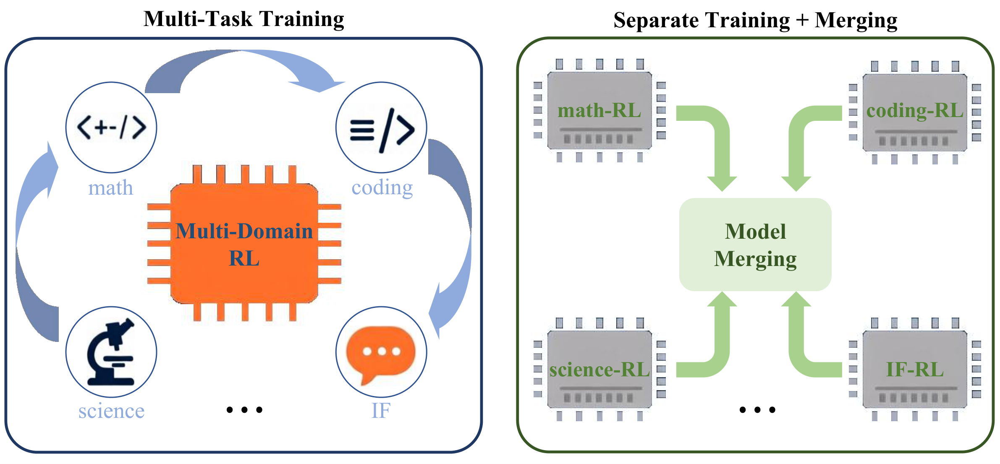
</p>

---

## ✨ Key Findings

- **Efficiency.** Mixed multi-task RLVR achieves comparable performance with separate RLVR followed by model merging while using only 58.3% of the GPU hours. Under a matched compute budget, multi-task RLVR is even +4.15 points better on average across 9 benchmarks.
- **Little interference, strong synergy.** Cross-domain RLVR exhibits small mutual interference; reasoning-intensive domains (math, coding, science) are mutually synergistic, and instruction following also benefits the reasoning domains.
- **Policy neighborhood transfer.** Using KL divergence to analyze weight merging, we find that neighborhood policy transfer shapes domain policies toward the optimal policy, explaining the gains from merging (e.g., merging the coding expert into the math one improves math).
- **Capability acquisition differs.** Weight merging primarily inherits single-task capabilities, whereas multi-task training and on-policy distillation develop emergent capabilities that diverge more from single-task learning.
- **Self-verification trade-off.** RLVR induces an emergent self-verification ability that is highly sensitive to task characteristics and training paradigm. Agentic, multi-turn interaction is a strong catalyst for robust process-level verification, while multi-task RLVR — though efficient — causes a severe degradation in process verification.

---

## 🧪 Experimental Setup

**Base Model:** `Qwen3-4B-Base` &nbsp;·&nbsp; **RL Algorithm:** GRPO &nbsp;·&nbsp; **Framework:** [slime](https://github.com/THUDM/slime)

**Pipeline:** a simplified **SFT → RL** recipe for controllable experiments.
1. **SFT** on ~14M samples (one epoch) to develop basic conversational and task-solving capabilities.
2. **RLVR** with GRPO, per-domain or mixed multi-task, followed by model merging for the separate-training paradigm.

**Domains & Datasets** (open-source, from [Nemotron-3 Nano](https://huggingface.co/collections/nvidia/nemotron-post-training-v3)):

| Domain | RL Samples | Source |
| :--- | :---: | :--- |
| Math | 22,056 | DAPO, Skywork-OR1 |
| Coding | 19,169 | CodeContests, Open-R1 |
| Science | 19,670 | OpenScienceReasoning-2 |
| Instruction Following | 16,575 | WildChat-1M + Open-Instruct |
| Agent | 10,229 | Nemotron-RL-agent-workplace-assistant |

SFT data blend follows the Nemotron-3 Nano proportions ([RL blend](https://huggingface.co/datasets/nvidia/Nemotron-3-Nano-RL-Training-Blend)):

| Data Type | #Samples | Proportion (%) |
| :--- | :---: | :---: |
| Math Formal Proofs | 335,122 | 2.37 |
| Math | 2,950,525 | 20.89 |
| Science | 2,263,340 | 16.04 |
| Code | 3,927,984 | 27.81 |
| Chat | 4,309,780 | 30.52 |
| Conversational Agent | 335,122 | 2.37 |
| **Total** | **14,121,873** | **100.00** |

---

## 📊 Main Results

**Benchmarks (Avg@K):** AIME'24 / AIME'25 (Math), LiveCodeBench v5 / v6 (Coding), HLE / GPQA-Diamond (Science), IFEval / IFBench (Instruction Following), BFCL v3 (Agent).

### **Evaluation across 5 domains**

The highest and second-best scores are in **bold** and <u>underlined</u>.

| Benchmark | Qwen3-4B-Base | SFT | RL-Math | RL-Coding | RL-Science | RL-IF | RL-Agent | Merging | RL-Multi |
| :--- | :---: | :---: | :---: | :---: | :---: | :---: | :---: | :---: | :---: |
| AIME'24 | 9.65 | 56.04 | 77.66 | 61.61 | 64.69 | 67.81 | 57.60 | <u>80.57</u> | **81.20** |
| AIME'25 | 5.68 | 51.30 | 70.42 | 55.16 | 56.35 | 60.52 | 54.64 | **74.48** | <u>73.39</u> |
| LCB v5 | 16.50 | 55.92 | 59.59 | **65.00** | 57.66 | 60.80 | 62.95 | <u>63.31</u> | 63.21 |
| LCB v6 | 18.29 | 52.00 | 54.57 | **58.86** | 53.14 | 53.14 | 54.29 | <u>58.86</u> | 56.57 |
| HLE | 4.45 | 5.75 | 6.39 | 5.92 | 6.26 | 7.04 | 5.98 | **7.25** | <u>7.18</u> |
| GPQA-Diamond | 20.08 | 42.68 | **58.46** | 46.59 | 53.79 | 49.62 | 46.09 | <u>55.18</u> | 53.62 |
| IFEval (strict) | 35.12 | 79.48 | 80.59 | 78.74 | 78.93 | 90.94 | 81.33 | **93.90** | <u>93.53</u> |
| IFBench | 11.90 | 38.44 | 40.14 | 39.46 | 40.14 | <u>59.52</u> | 40.82 | 59.18 | **61.22** |
| BFCL v3 | 29.73 | 50.05 | 50.32 | 50.64 | 49.56 | 50.55 | 59.14 | **61.37** | <u>60.74</u> |

Each single-domain RLVR model reaches state-of-the-art performance within its own domain, while both **Merging** and **RL-Multi** aggregate these gains and even improve further (e.g., AIME'24, AIME'25, HLE, IFEval, BFCL v3) — confirming the cross-domain gain effect.

### **Efficiency: Mix vs. Merge**

| Method | Math-RL | Coding-RL | Science-RL | IF-RL | Agent-RL | MT-OPD | Multi-Task RL |
| :--- | :---: | :---: | :---: | :---: | :---: | :---: | :---: |
| #Steps | 400 | 400 | 400 | 400 | 400 | 300 | 1000 |
| GPU Hours | 4782.3 | 6404.4 | 1140.8 | 1180.0 | 2271.0 | 1451.9 | **10050.6** |

Multi-task RLVR (10050.6 GPU hours) reaches comparable performance to separate RLVR + merging (5 experts, 15778.5 GPU hours) using only **58.3%** of the compute. Under a matched budget (5×200-step experts vs. 1000-step multi-task), multi-task RLVR is **+4.15 points** better on average.

### **Comparison of model merging methods**

| Method | AIME'24 | AIME'25 | LCB v5 | LCB v6 | HLE | GPQA-D | IFEval | IFBench | BFCL v3 | Avg. |
| :--- | :---: | :---: | :---: | :---: | :---: | :---: | :---: | :---: | :---: | :---: |
| Average | 67.55 | 64.38 | 58.92 | 57.71 | 6.16 | 50.13 | 84.84 | 40.82 | 53.17 | 53.74 |
| SCE | 80.73 | 74.84 | 62.01 | 56.57 | 7.28 | 56.57 | 93.35 | 53.74 | 61.19 | 60.70 |
| Ties | **81.15** | 74.74 | 60.84 | 57.71 | **7.92** | **57.58** | 92.61 | 54.76 | **61.73** | 61.00 |
| Ties+DARE | 79.84 | 75.89 | 60.71 | 57.71 | 7.41 | 57.07 | 90.94 | 56.12 | 61.05 | 60.75 |
| TA | 80.47 | **76.61** | 57.97 | 52.57 | 6.39 | 54.04 | 93.16 | 61.56 | 59.25 | 60.22 |
| TA+DARE | 81.09 | 76.18 | 58.65 | 56.00 | 6.39 | 55.56 | 93.72 | **62.59** | 58.76 | 60.99 |
| MT-OPD | 80.57 | 74.48 | 63.31 | **58.86** | 7.25 | 55.18 | **93.90** | 59.18 | 61.37 | **61.57** |
| MT-OFF | 80.78 | 76.30 | **63.98** | 57.14 | 7.23 | 49.24 | 89.09 | 60.88 | 60.12 | 60.53 |

**TA** = task arithmetic, **MT-OPD/MT-OFF** = multi-teacher on/off-policy distillation. On-policy distillation is only marginally better than direct weight merging but requires extra compute; different merging methods show a seesaw effect across benchmarks.

Notably, our best model trained purely on open-source data reaches performance comparable to the official Qwen3-4B (Thinking mode): 61.18 vs. 52.94 average across the 9 benchmarks.

### **Cross-domain synergy during training**

<p align="center">
  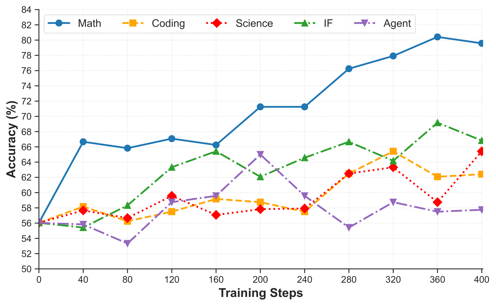
  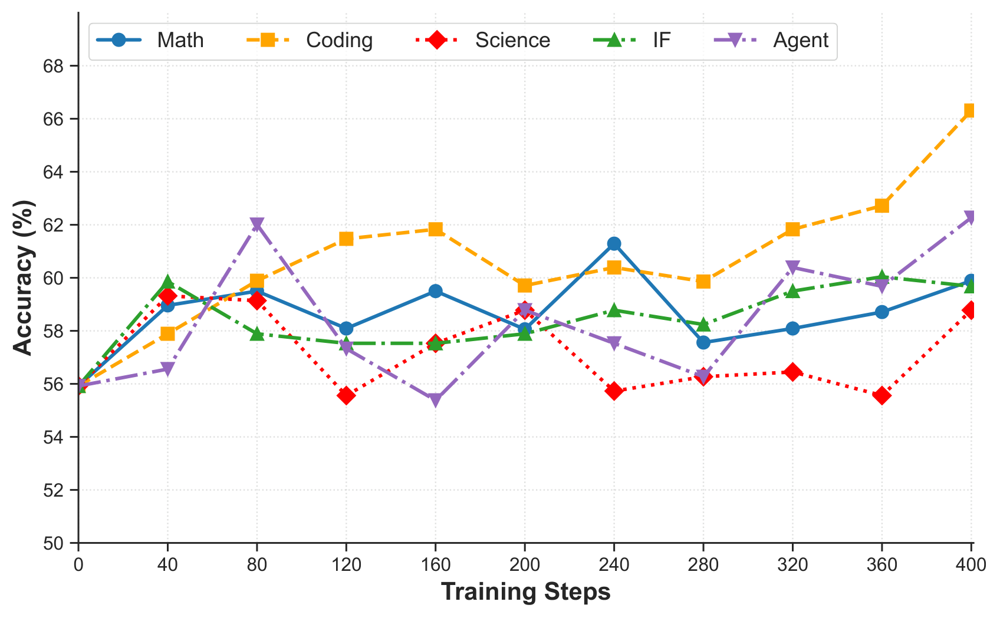
  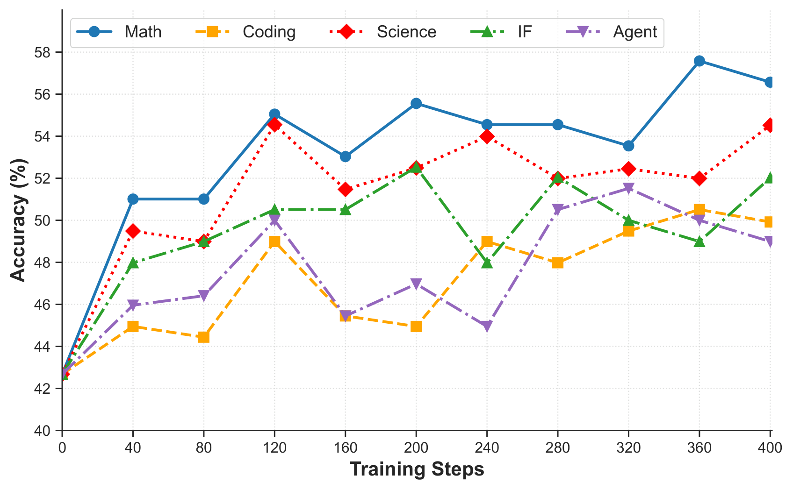
  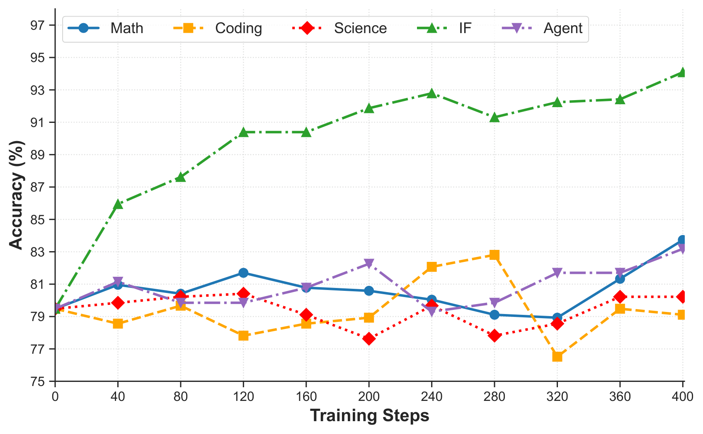
  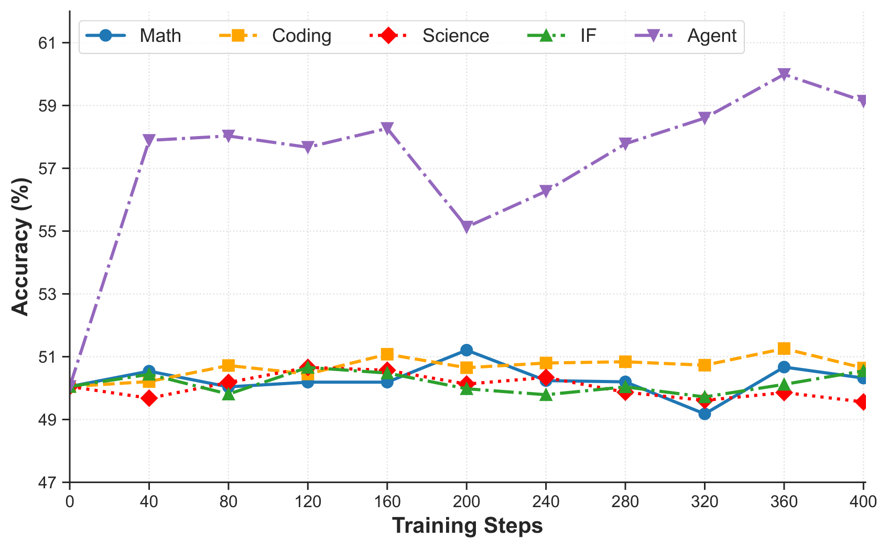
</p>

The accuracy trajectories during each single-domain RLVR process show that the three reasoning domains (math, coding, science) stably improve each other, and instruction following further helps the reasoning domains. The agent domain benefits only when tool-use trajectories are present (i.e., jointly trained), while cross-domain interference on it remains small.

---

## 🔬 Mechanism Analysis

### **Explore Policy Neighborhoods**

<p align="center">
  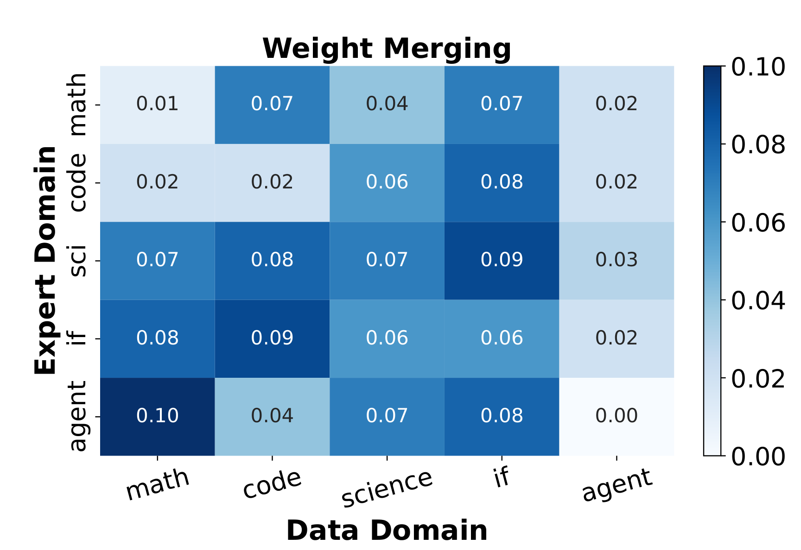
</p>

We cross-compare the KL divergence between domain experts and the merged multi-domain model on trajectories across domains. For a given data domain, experts from *other* domains can also exhibit low KL divergence with the merged policy — we formalize these as **policy neighborhoods**. Merging with a policy-neighborhood expert further improves the target domain (e.g., Math+Coding: AIME'24 ↑2.63, AIME'25 ↑2.02), while non-neighboring experts yield no extra gains. The relation is **asymmetric** (coding is a neighbor of math, but not vice versa), consistent with the asymmetry of KL divergence.

### **Do multi-task and merged models acquire the same skills as single-task models?**

<p align="center">
  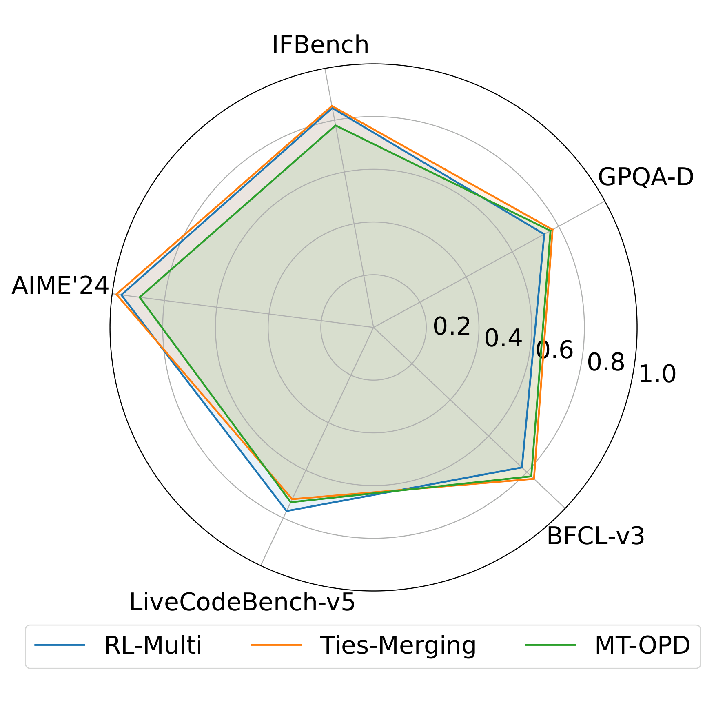
</p>

Measuring the cosine similarity between each multi-domain model's per-instance gain vector and the union of single-task gains (right figure above), we find that **weight merging inherits the most single-task skills**, whereas RL-Multi and MT-OPD diverge more — evidence of **emergent capabilities** arising from cross-domain synergy during joint training.

### **Dynamics of self-verification**

<p align="center">
  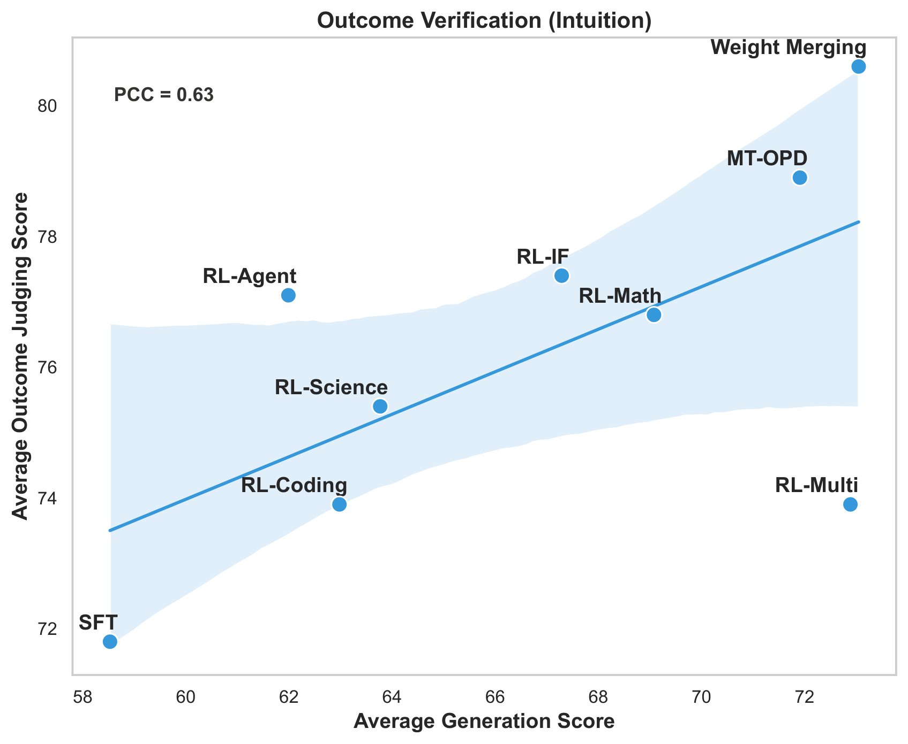
  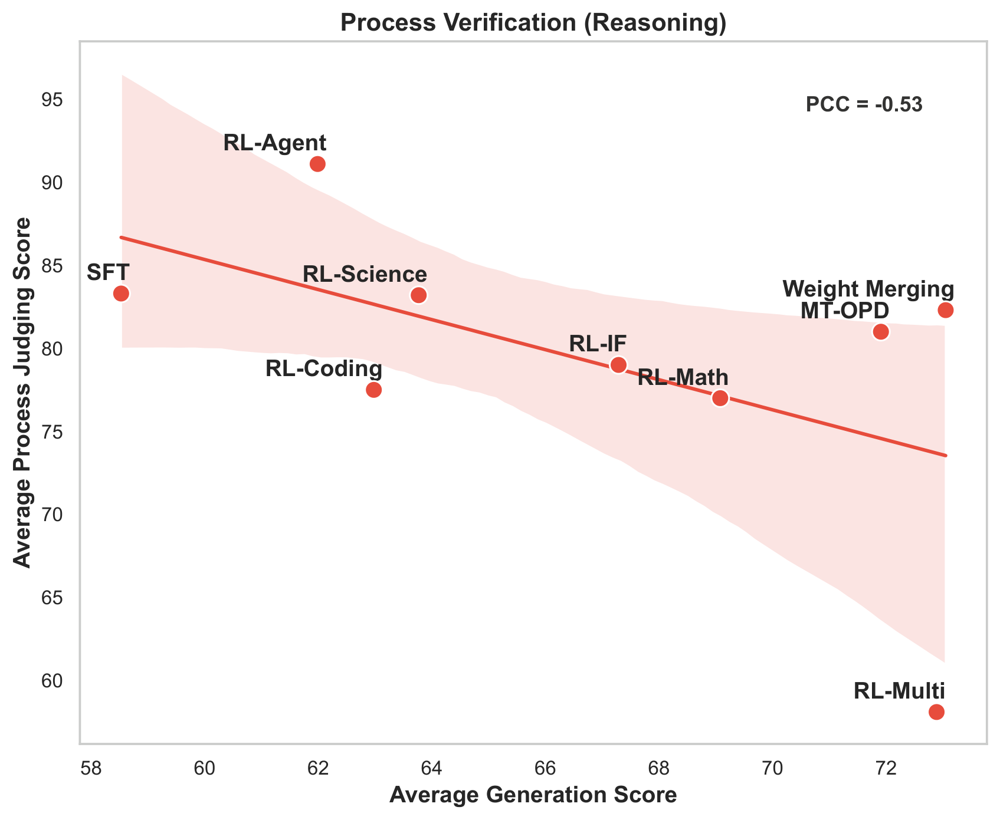
  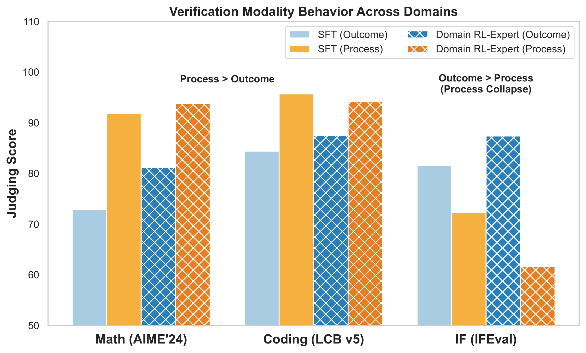
</p>

Evaluating RL-trained models as Generative Reward Models (GenRMs) on their own trajectories reveals:
- **Task characteristic dictates the verification modality.** For logic-intensive tasks (math, coding), **process-based** verification wins; for constraint-intensive tasks (instruction following), **outcome-based** verification wins.
- **The agent expert excels at process verification** (e.g., 95.3 on AIME, 99.4 on LCB, 88.5 on IFEval), because multi-turn tool-use training forces dynamic self-monitoring.
- **Robustness–efficiency trade-off.** Multi-task RLVR is efficient but its average process-verification score **collapses to 58.1**, far behind merging methods, which decouple expert training and preserve robust verification.

### **Explore Weight Shift**

<p align="center">
  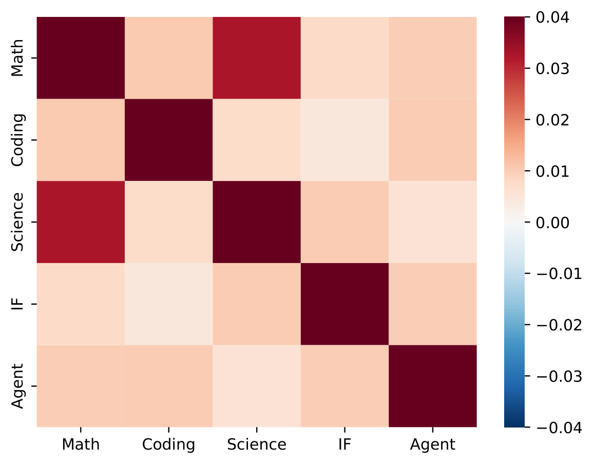
  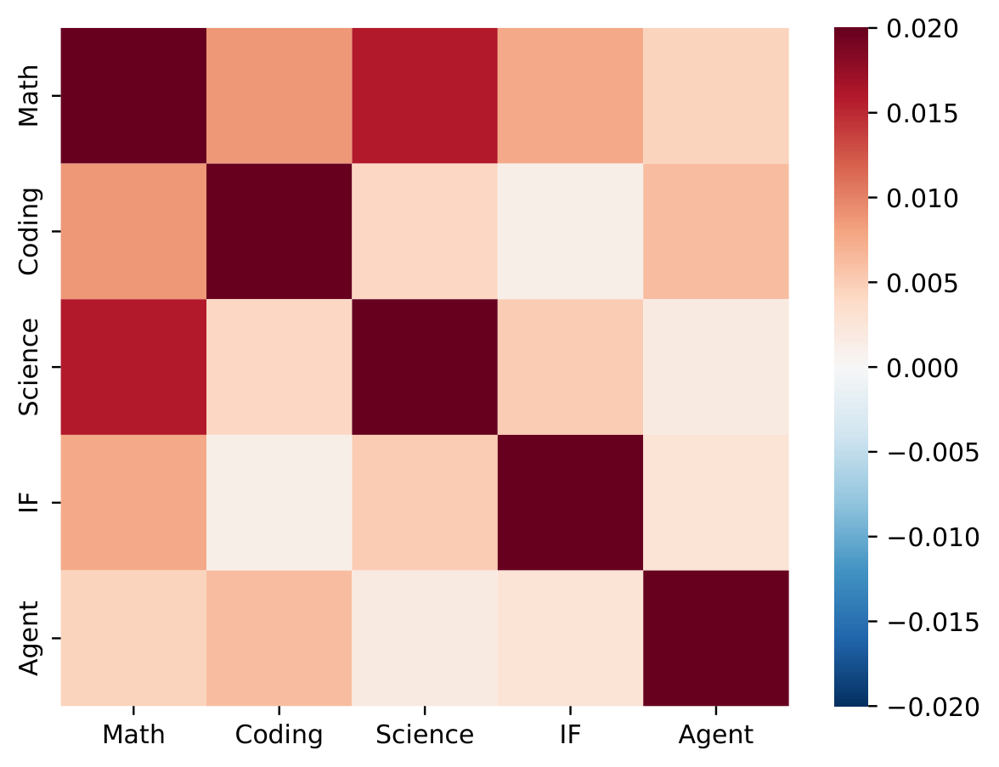
</p>

The weight-update footprints of different domain-specific RL models **significantly overlap** (Jaccard ≈ 0.46–0.48 vs. ~0.18 random), and the weight-shift vectors have **positive cosine similarity** in overlapping regions — highest among the three reasoning domains. This holds robustly across layers and thresholds.

---

## 💡 Practical Guidance

- Prefer **multi-task RLVR** when compute is limited or emergent cross-domain capabilities are desired; prefer **separate RLVR + merging** when maximizing single-domain performance or preserving self-verification ability.
- To build a stronger single-domain expert, mix in data from **beneficial neighboring domains** (e.g., coding/STEM data helps math).
- Align the **verification modality with the error locus**: process-based rewards for logic-intensive tasks, outcome-based rewards for constraint-intensive tasks.

---

## 🚀 Reproduction

Full instructions for environment setup, data processing, SFT, single/multi-task RL, model merging, and multi-teacher distillation are in [`M2RL/README.md`](M2RL/README.md). The pipeline is verified on 32 × H800 GPUs.

---

## 📚 Citation

If you find this work useful, please consider citing:

```bibtex
@inproceedings{
wang2026to,
title={To Mix or To Merge: Toward Multi-Domain Reinforcement Learning for Large Language Models},
author={Haoqing Wang and Xiang Long and Ziheng Li and Yilong Xu and Tingguang Li and Yehui Tang},
booktitle={Third Conference on Language Modeling},
year={2026},
url={https://openreview.net/forum?id=jP7j5XkG8J}
}
```
